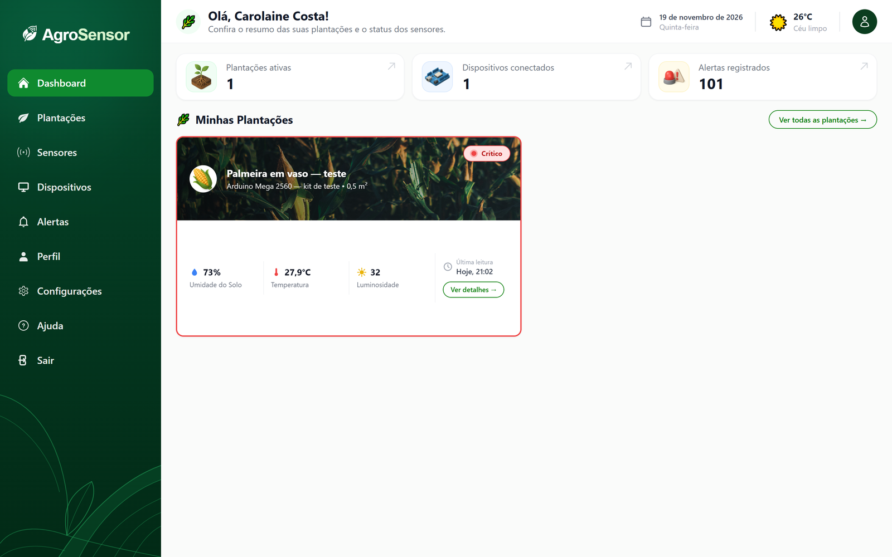
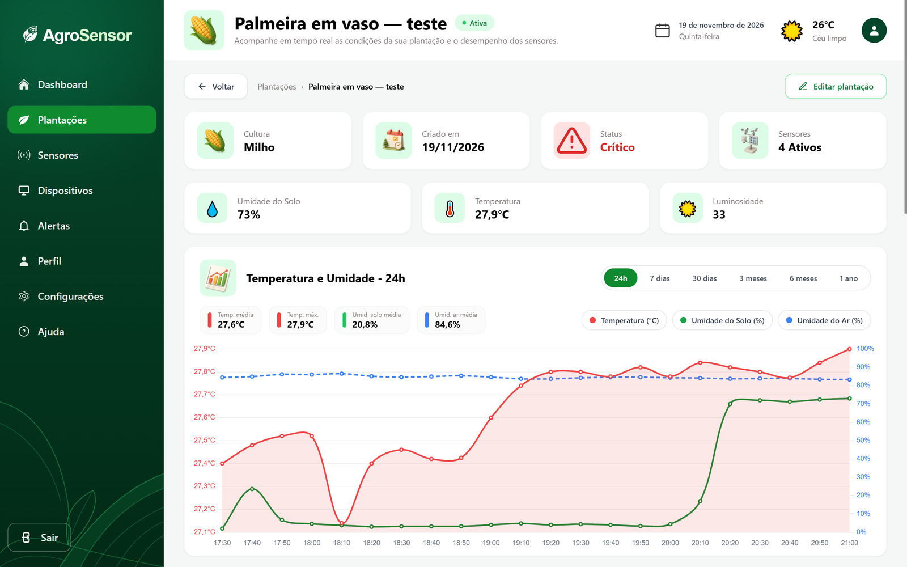
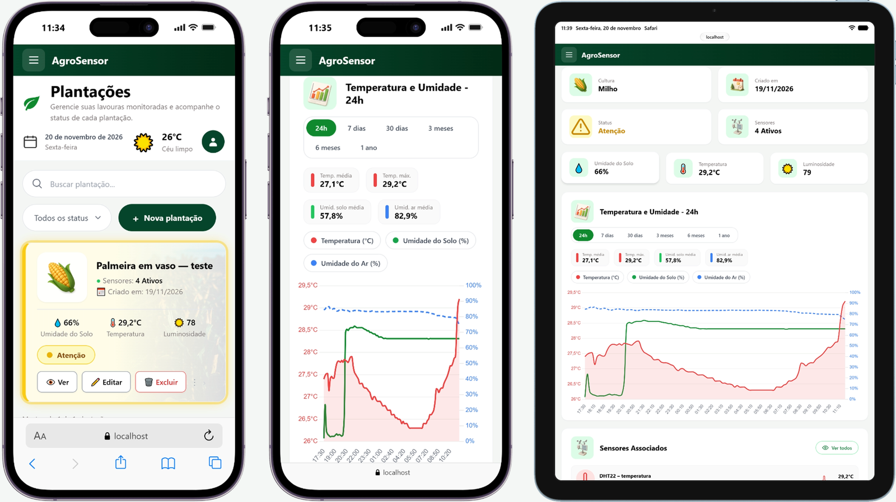
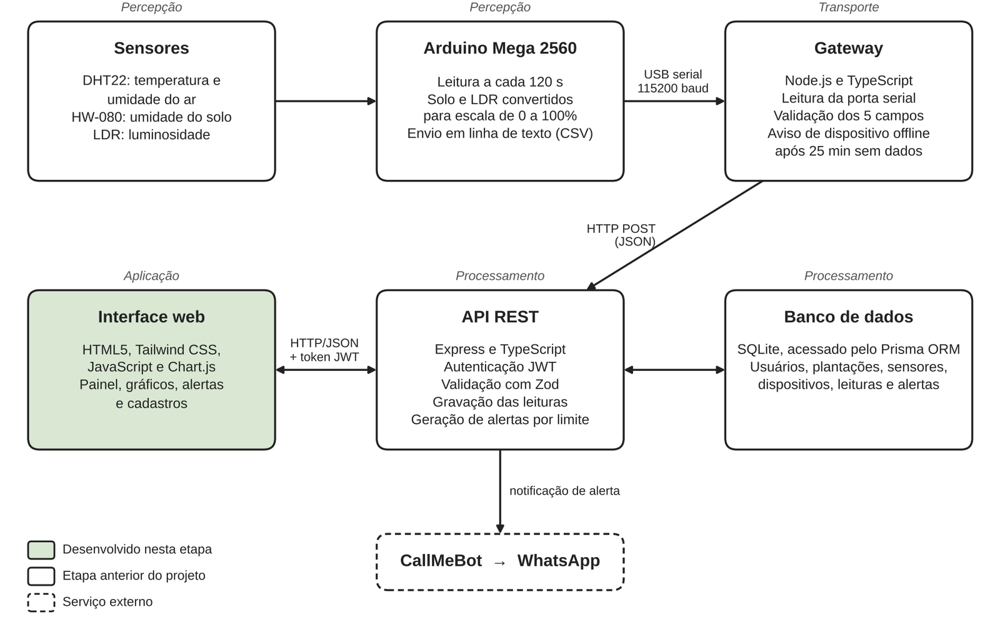
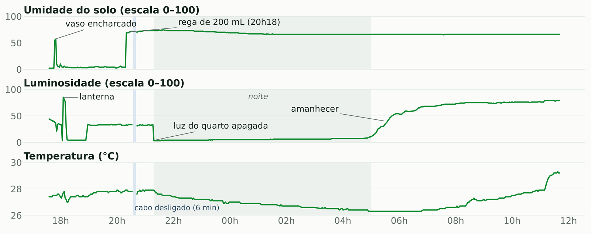

<div align="center">

# 🌱 AgroSensor

**Monitoramento ambiental de baixo custo para a agricultura familiar do Vale do Jequitinhonha**

Sensores ligados a um Arduino, um *gateway* serial, uma API REST e uma interface web para acompanhar<br>
temperatura, umidade do ar, umidade do solo e luminosidade das plantações.


Projeto Integrador · Tecnologia em Análise e Desenvolvimento de Sistemas<br>
**Instituto Federal do Norte de Minas Gerais (IFNMG) · Campus Araçuaí**

[Sobre](#-sobre-o-projeto) ·
[Telas](#-interface-web) ·
[Arquitetura](#-arquitetura) ·
[Estado atual](#-estado-atual) ·
[Testes](#-testes) ·
[Como executar](#-como-executar) ·
[Equipe](#-equipe)

</div>

---

## 📖 Sobre o projeto

No Vale do Jequitinhonha, a agricultura familiar convive com longos períodos de estiagem e grande variação climática, e o acompanhamento das condições da lavoura costuma ser feito apenas pela observação diária do produtor. O **AgroSensor** propõe uma forma acessível de registrar essas condições de maneira contínua, com componentes eletrônicos de baixo custo.

Sensores ligados a um **Arduino Mega 2560** medem a temperatura, a umidade do ar, a umidade do solo e a luminosidade a cada 2 minutos. As leituras seguem pelo cabo USB até um ***gateway*** em Node.js, que as envia a uma **API REST**. A API armazena os dados, compara cada leitura com os limites configurados para a plantação e gera **alertas**, que podem ser enviados por **WhatsApp**. Pela **interface web**, o produtor cadastra plantações, sensores e dispositivos e acompanha leituras, gráficos e alertas.

O projeto foi desenvolvido em duas etapas:

| Etapa | Foco |
|---|---|
| **Projeto Integrador I** | Firmware do Arduino, *gateway* serial, API REST, banco de dados, regras de negócio e alertas por WhatsApp |
| **Projeto Integrador II** | Interface web, visualização gráfica das leituras, integração com a API e ensaio com o kit de sensores |

---

## 🖥 Interface web

<p align="center">
  
  
</p>
<p align="center"><sub>Painel e detalhe da plantação durante o ensaio de 19/11/2026, com leituras reais do kit de sensores.</sub></p>

São **20 páginas** em HTML, Tailwind CSS e JavaScript, com gráficos em Chart.js:

| Área | Telas |
|---|---|
| Entrada | Tela inicial, *login*, cadastro, recuperação e redefinição de senha |
| Painel | Indicadores (plantações ativas, dispositivos conectados e alertas), clima do dia e situação de cada plantação |
| Plantações | Lista com busca e filtro, cadastro, edição, detalhe com gráfico por período e telas de apoio |
| Sensores e dispositivos | Cadastro, edição e exclusão, com a contagem de dispositivos *online* e *offline* |
| Alertas | Lista com filtros por gravidade e marcação de alertas como resolvidos |
| Conta | Perfil, configurações de notificação, ajuda e página de erro |

A situação de cada plantação (**ideal**, **atenção** ou **crítica**) vem do último alerta ainda não resolvido. O clima do cabeçalho é consultado no serviço Open-Meteo, pela localização do navegador ou, sem permissão, para Araçuaí.

<p align="center">
  
</p>
<p align="center"><sub>Abaixo de 1024 px, o menu lateral vira um menu recolhível. Capturas em emulação de iPhone 14 Pro e iPad Air.</sub></p>

Os protótipos no Figma e o guia de estilos estão em [`design-ux-ui/`](design-ux-ui/).

---

## 🏗 Arquitetura

<p align="center">
  
</p>

O Arduino **não tem Wi-Fi**: a comunicação com o *gateway* é feita pelo cabo USB, e o *gateway* roda em um computador ligado à placa.

### Fluxo de uma leitura

1. A cada 2 minutos, o Arduino lê os sensores e envia pela porta serial a linha `plantacao_id,umidade_solo,umidade_ar,temperatura,luminosidade`. O identificador da plantação está no próprio firmware.
2. O *gateway* confere se a linha tem os cinco campos e se os valores são numéricos, e envia a leitura à API em JSON.
3. A API valida os dados com Zod e grava a leitura no banco.
4. Para cada sensor vinculado à plantação, o valor é comparado com os limites de **atenção** e **crítico**.
5. Se um limite for ultrapassado, a API registra um alerta e, conforme as preferências do usuário, envia uma mensagem por WhatsApp (CallMeBot).
6. A interface consulta a API e exibe as leituras, o gráfico histórico e os alertas.
7. Se a porta serial ficar 25 minutos sem dados, o *gateway* pede à API um aviso de dispositivo *offline* por WhatsApp.

### Backend em camadas

```text
Rotas → Controllers → Services → Models → Prisma ORM → SQLite
```

As rotas definem os *endpoints* e as validações; os *controllers* tratam requisição e resposta; os *services* concentram as regras de negócio; os *models* acessam o banco. O modelo conceitual e o modelo lógico do banco estão em [`documentacao/diagramas/`](documentacao/diagramas/).

---

## 📌 Estado atual

*Atualizado em 20/11/2026.*

| Item | Situação |
|---|---|
| Firmware, *gateway*, API REST, banco de dados e alertas | ✅ Implementados no PI I e testados em ambiente local controlado |
| Interface web (20 páginas) | ✅ Implementada |
| Integração da interface com a API | ✅ Implementada |
| Responsividade (computador, tablet e celular) | ✅ Implementada; verificada por emulação no navegador |
| Proteção de todas as rotas da API por *token* e isolamento por usuário | ✅ Implementados e testados |
| Resolução de alertas, conexão dos dispositivos e exportação CSV | ✅ Implementadas e testadas |
| Ensaio com o kit de sensores em vasos de plantas (18 horas) | ✅ Realizado em 19 e 20/11/2026 |
| Recuperação de senha | ✅ Implementada e testada em 24/11/2026 com o link exibido no terminal; o envio do e-mail pelo Resend ainda não foi testado |
| Aviso de dispositivo *offline* por WhatsApp | ⚠️ Implementado, ainda não testado |
| Verificação do número de WhatsApp no perfil | ⚠️ Simulada na interface |
| Testes em campo e com agricultores | ⏳ Não realizados |

Os requisitos funcionais e não funcionais, com a situação de cada um, estão em [`documentacao/requisitos.md`](documentacao/requisitos.md).

---

## 🛠 Tecnologias

| Camada | Tecnologias |
|---|---|
| Hardware | Arduino Mega 2560 · DHT22 (temperatura e umidade do ar) · HW-080 (umidade do solo) · LDR (luminosidade) |
| *Gateway* | Node.js 24 · TypeScript · SerialPort · Zod |
| *Backend* | Node.js 24 · Express 5 · TypeScript · Prisma ORM 7 · SQLite · JWT · bcryptjs · Zod |
| Interface | HTML5 · Tailwind CSS · JavaScript · Chart.js (Tailwind e Chart.js carregados por CDN) |
| Serviços externos | CallMeBot (WhatsApp) · Open-Meteo (clima) · Resend (e-mail, opcional) |
| Ferramentas | Git e GitHub · Visual Studio Code · Arduino IDE · Figma · brModelo · Draw.io |

---

## 🔐 Segurança

- Autenticação por **JWT**, enviado no cabeçalho `Authorization: Bearer <token>`.
- Todas as rotas de dados exigem o *token*, e cada usuário só acessa os próprios registros (resposta 403 nos demais).
- Rotas públicas: cadastro, *login*, recuperação de senha e as duas rotas usadas pelo *gateway* (`POST /api/leituras` e `POST /api/alertas/dispositivo-offline`).
- Senhas armazenadas como *hash* (**bcryptjs**) e entradas validadas com **Zod**.
- Tratamento de erros centralizado em um *middleware*.

---

## 🔄 API REST

Prefixo `/api`, porta padrão `3000`.

| Recurso | Rotas |
|---|---|
| Autenticação | `POST /auth/login` · `POST /auth/esqueci-senha` · `POST /auth/redefinir-senha` · `GET /auth/me` |
| Usuários | `POST /usuarios` · `GET /usuarios` · `GET /usuarios/:id` · `PUT /usuarios/:id` · `DELETE /usuarios/:id` |
| Plantações | `POST /plantacoes` · `GET /plantacoes` · `GET /plantacoes/:id` · `GET /plantacoes/usuario/:usuario_id` · `PUT /plantacoes/:id` · `DELETE /plantacoes/:id` |
| Sensores | `POST /sensores` · `GET /sensores` · `GET /sensores/:id` · `GET /sensores/tipo/:tipo` · `PUT /sensores/:id` · `DELETE /sensores/:id` |
| Dispositivos | `POST /dispositivos` · `GET /dispositivos` · `GET /dispositivos/:id` · `PUT /dispositivos/:id` · `DELETE /dispositivos/:id` |
| Vínculos plantação–sensor | `POST /plantacoes-sensores` · `GET /plantacoes-sensores/:id` · `GET /plantacoes-sensores/plantacao/:plantacao_id` · `GET /plantacoes-sensores/sensor/:sensor_id` · `PUT /plantacoes-sensores/:id` · `DELETE /plantacoes-sensores/:id` · `DELETE /plantacoes-sensores/plantacao/:plantacao_id` |
| Leituras | `POST /leituras` · `GET /leituras` · `GET /leituras/exportar` (CSV) · `GET /leituras/dashboard/:plantacao_id` · `GET /leituras/plantacao/:plantacao_id` · `GET /leituras/:id` · `PUT /leituras/:id` · `DELETE /leituras/:id` |
| Alertas | `POST /alertas` · `POST /alertas/dispositivo-offline` · `PATCH /alertas/:id/resolver` · `GET /alertas` · `GET /alertas/:id` · `GET /alertas/plantacao/:plantacao_id` · `GET /alertas/resumo/:plantacao_id` · `GET /alertas/usuario/:usuario_id` · `DELETE /alertas/:id` |

A coleção de requisições usada para testar a API está no submódulo [`agrosensorAPIControl/`](agrosensorAPIControl/).

---

## 🧪 Testes

Todos os testes foram feitos pela equipe, manualmente, em ambiente local. O repositório não tem testes automatizados; a verificação de tipos do *backend* é feita com `npx tsc --noEmit`.

| Etapa | O que foi verificado | Resultado |
|---|---|---|
| **PI I** | Geração de alertas a partir de leituras fora dos limites, registro no banco e envio por WhatsApp | Funcionou |
| **Casos de teste da interface** | 9 casos: *login*, cadastros, exclusões, leituras, alertas, gráfico e limites | 4 problemas encontrados, depois corrigidos |
| **Ensaio com o kit (19 e 20/11/2026)** | Arduino → *gateway* → API → banco → interface, com sensores em vasos de plantas | 18 h de funcionamento contínuo, 370 leituras e 237 alertas; coleta retomada após desconectar o cabo |
| **Reteste das correções (20/11/2026)** | Proteção das rotas, isolamento por usuário, resolução de alertas, conexão dos dispositivos, exportação CSV e casos corrigidos | 11 verificações aprovadas |
| **Recuperação de senha (24/11/2026)** | Pedido do link, redefinição, *login* com a senha nova, recusa da senha antiga e do link já usado | Funcionou; o teste levou à recusa de senha igual à atual e ao aviso de link já usado (PR #137) |

<p align="center">
  
</p>
<p align="center"><sub>Leituras do ensaio: rega, apagar da luz do quarto, amanhecer e o intervalo em que o cabo foi desligado.</sub></p>

O ensaio revelou que o *gateway* descartava leituras iguais à anterior mesmo quando chegavam 2 minutos depois. A correção (PR #129) foi verificada com uma porta serial simulada, mas ainda não com o kit.

---

## ⚠️ Limitações conhecidas

- Os sensores **não foram calibrados**. A umidade do solo e a luminosidade são escalas de 0 a 100 derivadas do sinal elétrico, e não porcentagens reais.
- Alertas repetidos **não são agrupados**, e a resolução é manual, um alerta por vez.
- O *token* JWT vale 7 dias e não é renovado.
- O identificador da plantação é fixo no firmware: cada placa atende a uma plantação.
- A interface precisa de internet para carregar Tailwind CSS, Chart.js e o clima.
- A responsividade foi verificada por emulação, e não em aparelhos reais.
- O sistema ainda não foi testado em campo nem com agricultores.

---

## 🚀 Como executar

Os comandos funcionam no **Git Bash** (Windows) e em terminais Linux/macOS.

**Pré-requisitos:** Node.js 24 (versão em `backend/.nvmrc`) e npm, Git e, para gravar o firmware, a Arduino IDE.

### 1. Clonar o repositório

```bash
git clone https://github.com/carolainux/integrador-ifnmg-equipe2.git
cd integrador-ifnmg-equipe2
```

### 2. Backend

```bash
cd backend
npm install
```

Crie o arquivo `backend/.env` a partir do modelo e troque os valores de exemplo (as variáveis são validadas em `backend/src/env/index.ts`):

```bash
cp .env.exemplo .env
```

```env
DATABASE_URL="file:./dev.db"
JWT_SECRET="troque-por-uma-frase-secreta-com-32-caracteres-ou-mais"
CALLMEBOT_PHONE="5533999999999"
CALLMEBOT_APIKEY="sua-chave-callmebot"
PORT=3000
FRONTEND_URL="http://localhost:8080"

# Opcional: envio do e-mail de recuperação de senha pelo Resend
# RESEND_API_KEY="sua-chave-resend"
# EMAIL_FROM="onboarding@resend.dev"
# EMAIL_FROM_NAME="AgroSensor"
# EMAIL_DESTINO_TESTE="seu-email@exemplo.com"
```

**Recuperação de senha:** sem `RESEND_API_KEY` e `EMAIL_FROM`, nenhum e-mail é enviado. Fora de produção, o link de redefinição aparece no terminal da API, o que permite testar o fluxo sem conta no Resend. O remetente `onboarding@resend.dev` só entrega no e-mail do dono da conta Resend; para outros destinatários, é preciso verificar um domínio. Em desenvolvimento, `EMAIL_DESTINO_TESTE` envia todos os e-mails de recuperação para esse endereço. `FRONTEND_URL` deve ser o endereço em que a interface está aberta, porque é usado para montar o link.

Sem uma chave válida do CallMeBot, os alertas continuam sendo registrados, mas a mensagem de WhatsApp não é entregue.

Crie o banco, gere o cliente do Prisma e inicie a API:

```bash
npx prisma migrate deploy
npx prisma generate
npm run dev
```

A API fica disponível em `http://localhost:3000/api`.

> **Dados de demonstração:** `npx prisma db seed` **apaga todas as tabelas** e cria um cenário de exemplo, com os usuários listados em `backend/prisma/seed.ts`. Não rode em um banco com dados que você queira manter. `npm run db-perf` também apaga os dados.

### 3. Interface web

Em outro terminal, na pasta do projeto:

```bash
npx http-server frontend -p 8080
```

Acesse `http://localhost:8080/user/login.html`. A interface procura a API em `http://<endereço da página>:3000/api`; para usar outro endereço, defina-o no console do navegador:

```js
localStorage.setItem('agrosensor_api_base', 'http://localhost:3000/api');
```

### 4. Arduino

1. Abra `arduino/main/main.ino` na Arduino IDE.
2. Troque o valor de `plantacao_id` pelo `id` de uma plantação cadastrada no sistema.
3. Selecione a placa **Arduino Mega 2560** e a porta correspondente e faça o *upload*.

Para testar sem os sensores, use o *sketch* `arduino/main/main.test` (renomeie para `.ino`).

### 5. Gateway

Em outro terminal, com o Arduino conectado:

```bash
cd gateway
npm install
cp .env.exemplo .env
```

No `gateway/.env`, ajuste `SERIAL_PORT` para a porta do Arduino (por exemplo, `COM3` no Windows ou `/dev/ttyACM0` no Linux) e, se necessário, `BACKEND_URL`. Depois:

```bash
npm start
```

A primeira leitura chega à API cerca de 2 minutos depois que o Arduino é ligado.

---

## 📂 Estrutura do repositório

```text
integrador-ifnmg-equipe2/
├── arduino/main/            # Firmware do Arduino Mega 2560
├── gateway/                 # Leitura da porta serial e envio à API
├── backend/
│   ├── prisma/              # Esquema, migrações e dados de demonstração
│   └── src/                 # routes, controllers, services, models, middlewares, schemas, utils
├── frontend/
│   ├── script.js            # Sessão, comunicação com a API, menu e clima (compartilhado)
│   ├── style.css
│   ├── user/                # Login, cadastro, perfil e senha
│   ├── dashboard/           # Painel, alertas, configurações, ajuda e erro
│   ├── plantacao/           # Lista, cadastro, edição e detalhe
│   ├── sensores/  dispositivos/
│   └── assets/              # Imagens e ícones
├── design-ux-ui/            # Protótipos no Figma e guia de estilos
├── documentacao/            # Requisitos, regras de negócio, casos de uso, banco, atas e referências
│   ├── diagramas/           # Modelos conceitual e lógico do banco
│   └── imagens/             # Imagens usadas neste README
└── agrosensorAPIControl/    # Submódulo com a coleção de requisições da API
```

---

## 📚 Documentação

| Documento | Conteúdo |
|---|---|
| [`projeto.md`](documentacao/projeto.md) | Descrição do projeto |
| [`requisitos.md`](documentacao/requisitos.md) | Requisitos funcionais e não funcionais, com a situação de cada um |
| [`regras-negocio.md`](documentacao/regras-negocio.md) | Regras de negócio |
| [`casos-de-uso.md`](documentacao/casos-de-uso.md) | Casos de uso |
| [`modelagem-banco.md`](documentacao/modelagem-banco.md) | Modelagem do banco de dados |
| [`diagramas/`](documentacao/diagramas/) | Modelo conceitual, modelo lógico e diagrama do projeto |
| [`atas-reuniao.md`](documentacao/atas-reuniao.md) | Atas das reuniões da equipe |
| [`referencias.md`](documentacao/referencias.md) | Referências bibliográficas |

---

## 🔮 Trabalhos futuros

- Calibrar os sensores e repetir o ensaio, agora com a correção do *gateway*.
- Agrupar alertas repetidos e resolvê-los automaticamente quando as condições se normalizarem.
- Renovar o *token* de acesso.
- Configurar a plantação sem precisar regravar o firmware.
- Tornar o *gateway* autônomo ou sem fio, para testes no campo.
- Testar a interface com agricultores do Vale do Jequitinhonha e em celulares reais.

---

## 👥 Equipe

| Integrante | Função |
|---|---|
| **Carolaine Costa** | Product Owner (PO) |
| **Alex Alves Santos** | Desenvolvimento *backend* |
| **Jailson Santos da Silva** | Desenvolvimento *backend* |
| **Sandy Barbosa Fonseca** | UX/UI e desenvolvimento *frontend* |
| **Cybelle Leandro Bittencourt** | Qualidade e testes (QA) |

---

## 📖 Artigos

O Projeto Integrador I originou um artigo sobre a arquitetura, a implementação e os testes em ambiente controlado. O artigo do Projeto Integrador II, sobre a interface, a integração e o ensaio com os sensores, está em avaliação na disciplina.

---

## 📄 Licença

Projeto desenvolvido para fins acadêmicos. Os direitos sobre o código, a documentação e os demais artefatos pertencem aos seus autores. Sugestões podem ser enviadas por **Issues** ou **Pull Requests**.

<div align="center">

---

**AgroSensor** · Projeto Integrador · IFNMG Campus Araçuaí<br>
Vale do Jequitinhonha · Minas Gerais · Brasil

</div>
