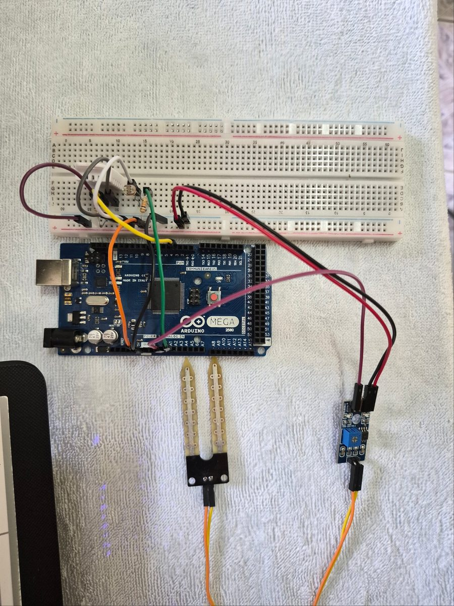
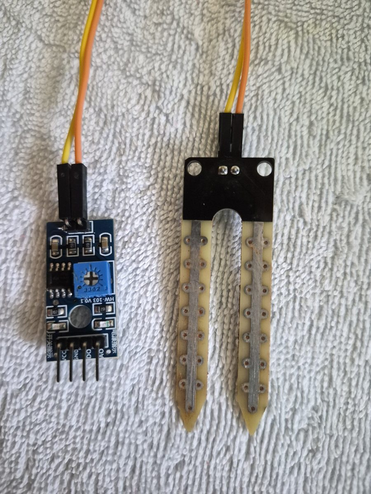
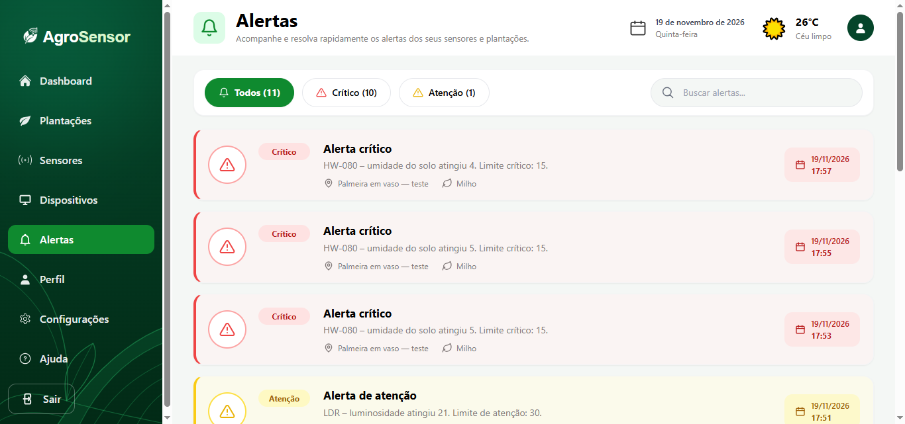
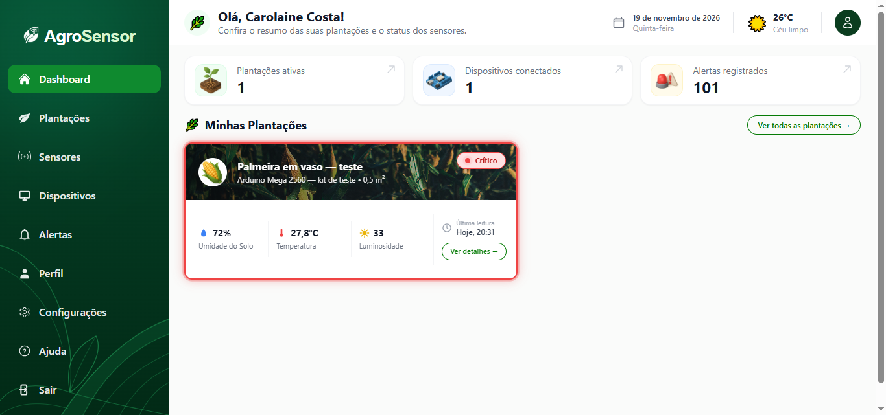
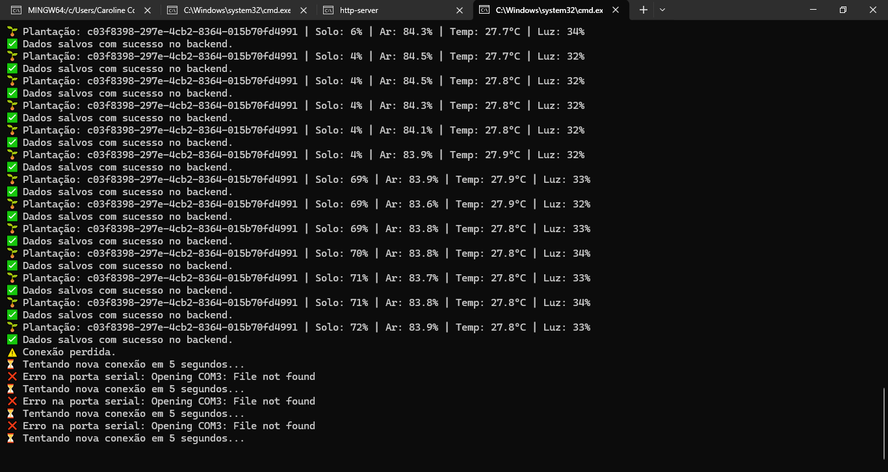
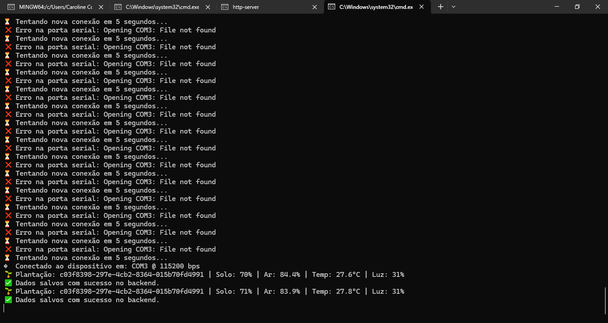
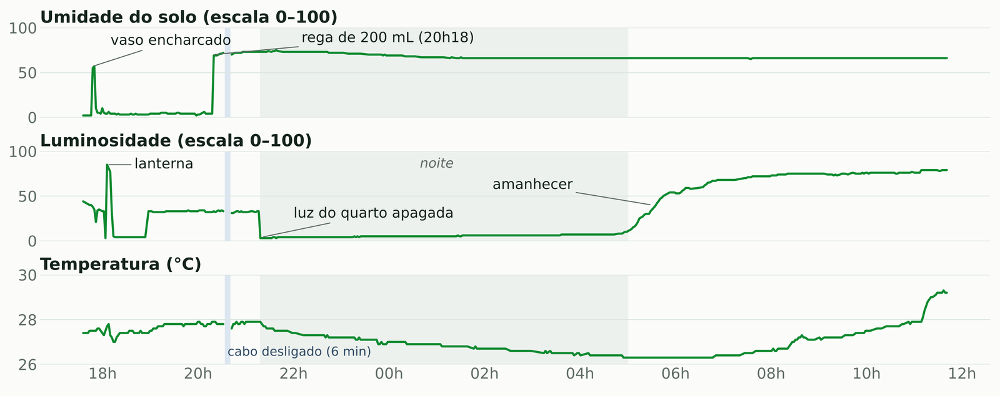

# 02 — Ensaio com o kit de sensores

| Item | Registro |
|---|---|
| Período | 19/11/2026, 17h35, a 20/11/2026, 11h40 (horário de Brasília) |
| Local | Ambiente interno ventilado, junto a uma janela, em Araçuaí (MG) |
| Plantas | Palmeira ornamental em vaso, com solo inicialmente seco (planta principal), e uma planta em outro vaso, com solo encharcado pela chuva (comparação) |
| Hardware | Arduino Mega 2560; DHT22 (pino 3, resistor de 10 kΩ); sonda HW-080 com módulo HW-103 (A0); LDR com resistor de 10 kΩ (A1) |
| Software | `main` no commit `92b04dd` (PR #128); Node.js 24; *gateway* na porta COM3, 115200 bps |
| Referências | Relógio digital com termômetro (resolução de 1 °C); nenhuma referência de umidade |
| Objetivo | Verificar o caminho completo Arduino → *gateway* → API → banco → interface com sensores reais e de forma contínua |

  
  

## Configuração no sistema

A plantação, os quatro sensores e o dispositivo foram cadastrados pela própria interface. Como a lista de culturas não tem palmeira nem a opção “outra”, a plantação foi cadastrada como milho, o que não interfere nos alertas. As notificações por WhatsApp foram desativadas para não enviar centenas de mensagens.

| Sensor | Direção do alerta | Atenção | Crítico |
|---|---|---|---|
| DHT22 – temperatura | Acima | 30 °C | 35 °C |
| DHT22 – umidade do ar | Abaixo | 40% | 30% |
| HW-080 – umidade do solo | Abaixo | 30 | 15 |
| LDR – luminosidade | Abaixo | 30 | 15 |

A umidade do solo e a luminosidade são escalas de 0 a 100 obtidas pelo firmware por conversão linear da leitura analógica; **não são porcentagens reais**, porque os sensores não foram calibrados.

## Procedimentos e resultados

| Etapa | Procedimento | Resultado |
|---|---|---|
| Pré-teste | Leituras pelo Serial Monitor antes da integração | Os três sensores responderam |
| Início | *Gateway* iniciado às 17h36 | Primeira leitura gravada na API; painel em “Crítico” com a sonda ainda fora da terra |
| Solo | Sonda no vaso encharcado e depois na palmeira seca | 55–57 no encharcado e 4–5 no seco, já na primeira leitura após a inserção |
| Luz | LDR coberto, luz natural do fim de tarde e lanterna do celular | 3, 33 e 77–85, na ordem esperada |
| Alertas | Conferência da tela de Alertas às 17h58 | 11 alertas, cada um correspondendo a uma leitura fora do limite |
| Rega | 200 mL de água na palmeira às 20h18 | Umidade do solo de 4 para 69 na primeira leitura seguinte |
| Desconexão (T6) | Cabo USB desligado das 20h34 às 20h40 | O *gateway* tentou reconectar a cada 5 s e voltou sozinho ao religar o cabo, sem reiniciar nenhum programa |
| Atualização da tela | Painel aberto sem recarregar (20h47–20h48) | A última leitura mudou sozinha no painel |
| Noite e manhã | Sistema sem intervenção até o encerramento | Luz caiu ao apagar a luz do quarto (21h18) e subiu com o amanhecer, a partir das 04h54 |

  
  

  
  

  

## Números do ensaio

| Medida | Valor |
|---|---|
| Duração | 18 h 05 min de funcionamento contínuo |
| Leituras gravadas no banco | 370 |
| Linhas recebidas pelo *gateway* | 371. A única não gravada foi a última, quando a API já tinha sido desligada no encerramento |
| Leituras esperadas (uma a cada 2 min) | 543 |
| Leituras ausentes | 173: cerca de 4 da desconexão do cabo e as demais descartadas pelo *gateway* (ver abaixo) |
| Alertas | 237: 148 críticos de luminosidade, 78 críticos de umidade do solo e 11 de atenção de luminosidade. O último foi às 05h26 de 20/11 |
| Temperatura | 26,3 a 29,3 °C |
| Umidade do ar | 73,5% a 87,3% |

Os dados completos estão em [`dados/leituras-ensaio-19-20-11-2026.csv`](dados/leituras-ensaio-19-20-11-2026.csv) e [`dados/gateway-ensaio.log`](dados/gateway-ensaio.log).

## Achados

1. **O *gateway* descartava leituras legítimas.** Os intervalos sem dados eram sempre múltiplos exatos de 2 minutos, e não havia duas leituras seguidas idênticas no banco. O *gateway* ignorava qualquer linha igual à anterior, mesmo recebida 2 minutos depois, uma proteção antiga contra linhas duplicadas da biblioteca serial. Com os valores estáveis de madrugada, leituras válidas foram descartadas sem aviso. **Corrigido no PR #129**: a linha repetida só é descartada se chegar menos de 5 s depois da anterior. A correção foi verificada com uma porta serial simulada, mas ainda não com o kit.
2. **Alertas repetidos, sem agrupamento.** Cada leitura fora do limite gera um alerta: só a escuridão da noite gerou 148 alertas críticos de luminosidade. Continua como limitação.
3. **A situação da plantação não voltava a “ideal”.** Às 11h20, com todas as leituras dentro dos limites, o painel ainda mostrava “Atenção”, porque a situação vinha do último alerta registrado. **Corrigido no PR #130**, com a resolução de alertas ([03-reteste-correcoes-pr130.md](03-reteste-correcoes-pr130.md)).
4. **O erro do caso 8 apareceu com dados reais.** O resumo do gráfico mostrava máxima de 27,8 °C, mas a maior leitura era 27,9 °C. **Corrigido no PR #130.**

## Limitações do ensaio

- Ambiente interno, com plantas em vasos, e não uma área de cultivo. Os vasos foram usados porque o *gateway* depende de um computador ligado ao Arduino por cabo USB, que não poderia ficar exposto ao calor e à umidade de uma lavoura.
- Sem referência para comparar a umidade do ar, a umidade do solo e a luminosidade; para a temperatura, apenas um termômetro com resolução de 1 °C.
- A terra encharcada marcou cerca de 60, e não 100: a escala reflete a faixa elétrica da sonda, e não o teor de água.
- O envio de notificações por WhatsApp não foi avaliado.
