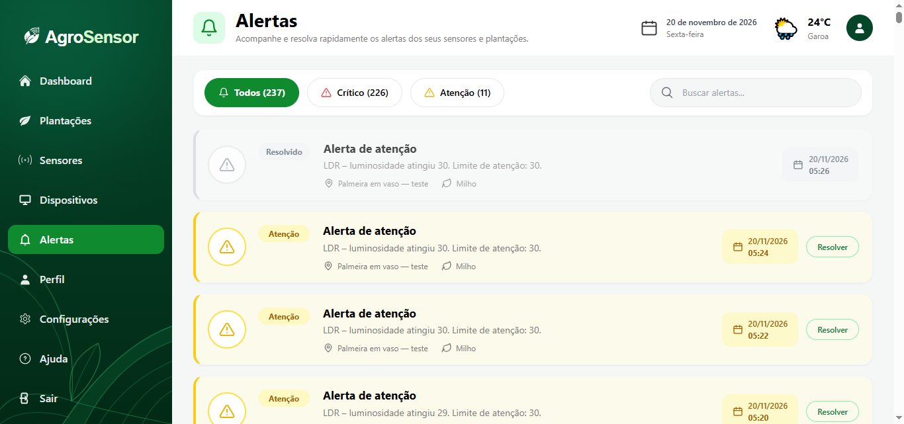
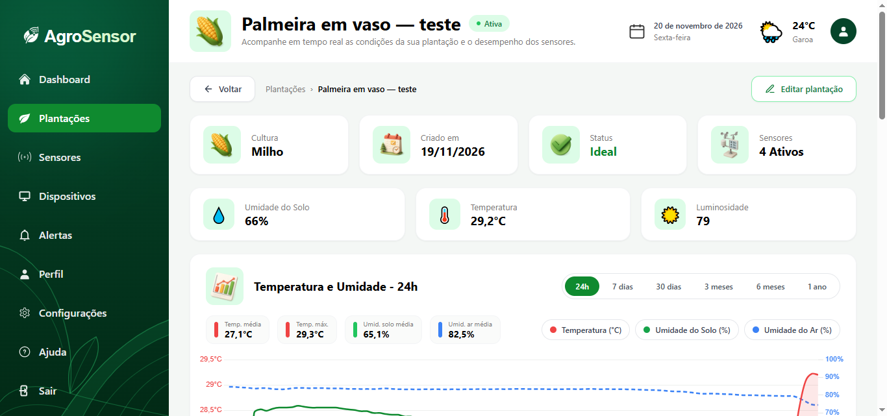
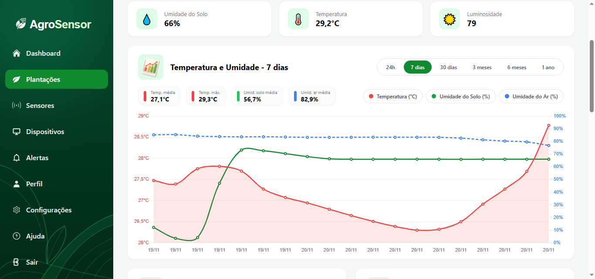
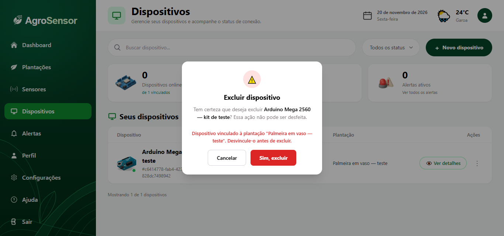
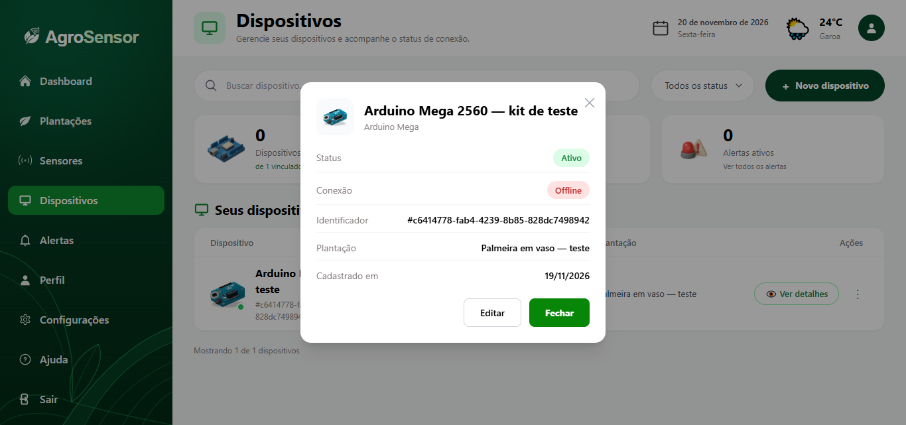
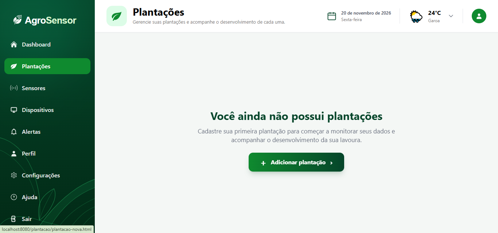

# 03 — Reteste das correções do PR #130

| Item | Registro |
|---|---|
| Data | 20/11/2026, das 19h36 às 20h03 |
| Versão testada | PR #130 (“Continuação da integração do *backend* com o *frontend*”), commit `fd377fd`, antes do *merge* |
| Ambiente | Computador da equipe (Windows); API na porta 3000; interface com `http-server` na porta 8080; banco com os dados do ensaio de 19 e 20/11 (com cópia de segurança antes da migração) |
| Migração aplicada | `20261117000000_adiciona_resolucao_alerta` (coluna `resolvido_em` na tabela de alertas) |
| Objetivo | Confirmar as correções dos problemas encontrados nos casos de teste e no ensaio antes de aceitar o PR |

O PR #130 passou a exigir *token* em todas as rotas de dados e a restringir cada usuário aos próprios registros, acrescentou a resolução de alertas, a situação de conexão dos dispositivos e a exportação das leituras em CSV, e corrigiu os casos 3, 5, 8 e 9.

## Verificações

| # | Verificação | Resultado |
|---|---|---|
| 1 | Rota de dados sem *token* (`GET /api/plantacoes`) | ✅ 401 “Token não fornecido.” ([evidência](dados/reteste-rota-protegida.txt)) |
| 1b | Rota do *gateway* sem *token* (`POST /api/leituras`) | ✅ Não exigiu *token*; recusou apenas porque a plantação informada não existia ([evidência](dados/reteste-rota-gateway-publica.txt)) |
| 2 | Resolver um alerta pela tela de Alertas | ✅ Alerta marcado como “Resolvido”; alertas ativos de 237 para 236 |
| 3 | Situação da plantação com todos os alertas resolvidos | ✅ “Ideal” no painel e no detalhe. Os 236 alertas restantes foram resolvidos por comando no console do navegador, usando a mesma rota do botão |
| 4 | Caso 8: máximo do resumo do gráfico | ✅ “Temp. máx.” de 29,3 °C em 24 horas e em 7 dias, igual à maior leitura |
| 5 | Caso 3: sensor escolhido sem clicar em “Adicionar” | ✅ Aviso “Clique em Adicionar para incluir o sensor selecionado.” |
| 6 | Caso 5: excluir dispositivo vinculado | ✅ Mensagem clara, pedindo para desvincular antes de excluir |
| 7 | Caso 9: roda do *mouse* no campo de limite | ✅ Valor de 40 mantido |
| 8 | Situação de conexão do dispositivo | ✅ “Offline” (última leitura às 11h40); painel com 0 dispositivos conectados |
| 9 | Exportação das leituras em CSV | ✅ 370 leituras, iguais às do banco, com máxima de 29,3 °C ([arquivo](dados/leituras-ensaio-19-20-11-2026.csv)) |
| 10 | Isolamento entre usuários | ✅ Uma conta nova não vê plantações, dispositivos nem alertas de outra conta |

**Resultado: 11 verificações aprovadas.** O PR foi incorporado à `main` em seguida (commit `60a21aa`).

  
  

  
  

  
  

## Observações (não impediram o *merge*)

1. Não existe “resolver todos”: voltar a “ideal” depois do ensaio exigiu resolver 236 alertas, um a um. Relaciona-se à falta de agrupamento de alertas.
2. Os filtros da tela de Alertas contam também os alertas resolvidos.
3. Na lista de dispositivos, a bolinha verde mostra a situação do cadastro (“Ativo”), e não a conexão (“Offline”).
4. O CSV traz os horários em UTC.
5. O cadastro com telefone repetido mostra uma mensagem genérica, sem indicar o campo.
6. Uma leitura para uma plantação inexistente recebe uma mensagem genérica de vínculo inválido.
7. No gráfico de 7 dias, o eixo horizontal mostra só a data, sem a hora.
8. O README tinha informações imprecisas sobre os testes e o ambiente. **Corrigido nos PRs #133 e #134.**
9. A situação volta a “ideal” apenas com a resolução manual dos alertas; não há resolução automática quando as leituras se normalizam.
