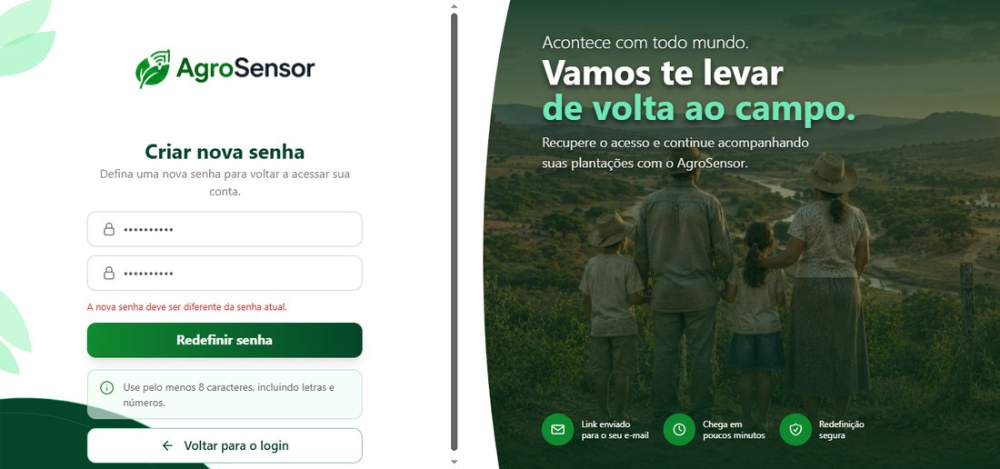

# 04 — Recuperação de senha (RF21)

| Item | Registro |
|---|---|
| Data | 24/11/2026 |
| Versão testada | 1ª rodada: `main` após o PR #136 (envio pelo Resend, do PR #135). 2ª rodada: `main` após o PR #137 |
| Ambiente | Computador da equipe (Windows); API na porta 3000 com `npm run dev`; interface com `http-server` na porta 8080 |
| Como o link foi obtido | Sem chave do Resend configurada, a API exibe o link de redefinição no terminal. **O envio do e-mail em si não foi testado** |
| Objetivo | Verificar o pedido do link, a troca da senha, o *login* depois da troca e o uso único do link |

## 1ª rodada

| Passo | Resultado |
|---|---|
| Pedir o link em “Esqueci minha senha” | ✅ “Link enviado!”; o link apareceu no terminal da API |
| Abrir o link e criar a nova senha | ✅ “Senha redefinida!” |
| Entrar com a nova senha | ✅ Painel aberto |
| Entrar com uma senha errada | ✅ Recusado: “E-mail ou senha inválidos.” |
| Nova senha **igual** à atual | ❌ Aceita |
| Abrir de novo o link já usado | ⚠️ O formulário abriu normalmente. Ao enviar uma senha, porém, o link foi recusado (“Link de recuperação inválido ou expirado.”) e a senha não mudou |

Como a senha nova foi igual à antiga, não foi possível verificar nesta rodada se a senha antiga deixa de valer.

**Correção (PR #137):** a API passou a recusar uma nova senha igual à atual, e a página de redefinição passou a verificar o link assim que abre, avisando e bloqueando os campos se ele já foi usado ou expirou.

## 2ª rodada

| Passo | Resultado |
|---|---|
| Pedir um novo link | ✅ Link exibido no terminal |
| Nova senha igual à atual | ✅ Recusada: “A nova senha deve ser diferente da senha atual.” |
| Nova senha diferente | ✅ “Senha redefinida!” |
| Entrar com a senha **antiga** | ✅ Recusado |
| Entrar com a senha **nova** | ✅ Painel aberto |
| Abrir de novo o link já usado | ✅ Aviso imediato: “Este link já foi usado ou expirou. Solicite um novo link.” |

**Resultado: aprovado.**

  
  

## Observações

- Com o link já usado, o botão “Redefinir senha” fica bloqueado, mas mantém a aparência de ativo.
- O remetente de testes do Resend (`onboarding@resend.dev`) só entrega mensagens no e-mail do dono da conta. Para enviar a outros usuários, é preciso verificar um domínio.
